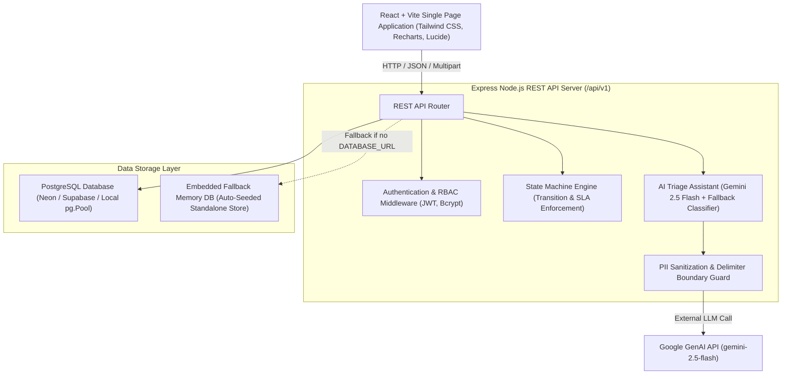

# 02. System Architecture: Kerala CMO Grievance Redressal Portal

## 1. High-Level Architectural Pattern
The application follows a modern full-stack single-service monolithic pattern designed for zero-configuration local execution and seamless cloud deployment (Render, Neon, Supabase, Cloud Run).

## 2. Component Breakdown

### Frontend Layer (React 19 + Vite 8)
- **Framework:** React 19 SPA with React Router 7.
- **Styling:** Tailwind CSS v4 utilizing responsive flex/grid layouts, accessible forms, contrast standards, and zero visual clutter.
- **Visual Analytics:** Recharts for CMO dashboard data visualization (District bar charts, Department workload comparisons, Status breakdown donut charts, and Monthly resolution velocity line charts).
- **State & Auth:** React Context (`AuthContext`) managing JWT tokens stored in `localStorage`, role privileges, and evaluator quick-switch functionality.

### Backend Layer (Express 4 + Node.js 22)
- **API Architecture:** RESTful API strictly namespaced under `/api/v1`.
- **Security:** Helmet headers, CORS allow-listing, Zod schema validation on all incoming request payloads, parameterized query sanitation, and password hashing using bcrypt with 10 salt rounds.
- **State Machine Validator:** Enforces server-authoritative status transitions (`Submitted` -> `Under Review` -> `In Progress` -> `Action Submitted` -> `Resolved` -> `Under Review`), returning HTTP 409 Conflict upon illegal jumps.
- **File Ingestion:** Multer handling file validation (JPEG, PNG, PDF only; max 2 MB) and persisting files as binary `bytea` in PostgreSQL for stateless container resilience.

### AI Pipeline (`server/aiService.ts`)
- **Primary Engine:** `@google/genai` invoking `gemini-2.5-flash` with low temperature (0.1) and JSON schema response formatting.
- **Prompt Injection Defense:** Strict input enclosure using `<<<USER_COMPLAINT>>>` and `<<<END_USER_COMPLAINT>>>` delimiters with system prompt directives instructing the model to treat all complaint text purely as data.
- **PII Scrubbing:** Redacts Indian phone numbers, email addresses, and 12-digit Aadhaar patterns before any external network transmission.
- **Timeout & Fallback:** 8000ms Promise.race timeout. Upon failure, timeout, or missing API key, the system transitions gracefully to a rule-based/TF-IDF keyword classifier (`fallback-keyword`) with 100% operational uptime.

### Database Layer (`server/db.ts`)
- **Primary:** PostgreSQL 16+ via `pg.Pool` utilizing foreign key cascades, unique indexes, and `pg_trgm` similarity.
- **Hybrid Resilience:** If `DATABASE_URL` is omitted, the portal automatically loads an embedded database engine populated with 12 Kerala departments, 14 districts, 16 users, and 40 rich complaints across all statuses.
