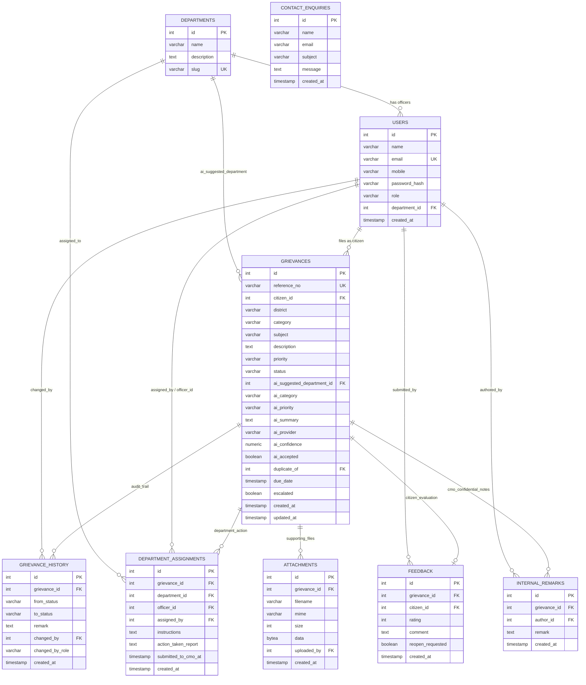

# 03. Database Design: Kerala CMO Grievance Redressal Portal

## 1. Entity-Relationship (ER) Diagram



## 2. Table Specifications & Constraints

### `departments`
Stores participating government bodies.
- `id`: Serial primary key
- `name`: Full official departmental title (e.g. `Public Works Department (PWD)`)
- `slug`: Unique shortcode (`pwd`, `kwa`, `kseb`, etc.)

### `users`
Multi-role user registry.
- `role`: Restricted to `citizen`, `cmo_admin`, or `dept_officer`.
- `password_hash`: Bcrypt hashed string with salt factor 10.
- `department_id`: Non-null for `dept_officer`, references `departments(id)`.

### `grievances`
Core complaint records.
- `reference_no`: Unique sequential alphanumeric ID formatted as `CMK-2026-XXXXXX`.
- `priority`: `Low` (14 days SLA), `Medium` (7 days SLA), `High` (3 days SLA).
- `status`: Enforced state `Submitted`, `Under Review`, `In Progress`, `Action Submitted`, or `Resolved`.
- `due_date`: Calculated upon creation based on priority SLA.
- `ai_accepted`: Boolean flag recording whether citizen/CMO confirmed the AI suggestion.

### `grievance_history`
Append-only immutable audit trail.
- Every status transition writes a new row containing previous status, target status, remark, changed_by user, and role.

### `attachments`
Stores proof photographs and documents.
- `data`: Stored as `BYTEA` in PostgreSQL, enabling stateless container deployment without ephemeral disk data loss.
- Max file size: 2 MB. Accepted MIME types: `image/jpeg`, `image/png`, `application/pdf`.

### `feedback`
Post-resolution evaluation.
- `rating`: Integer 1 to 5 stars.
- `reopen_requested`: Boolean trigger that transitions resolved cases back to `Under Review`.

## 3. Database Indexes
```sql
CREATE INDEX idx_grievances_ref_no ON grievances(reference_no);
CREATE INDEX idx_grievances_status ON grievances(status);
CREATE INDEX idx_grievances_district ON grievances(district);
CREATE INDEX idx_grievances_category ON grievances(category);
CREATE INDEX idx_grievances_dept ON grievances(ai_suggested_department_id);
CREATE INDEX idx_history_grievance ON grievance_history(grievance_id);
CREATE INDEX idx_dept_assignments_grievance ON department_assignments(grievance_id);
```
